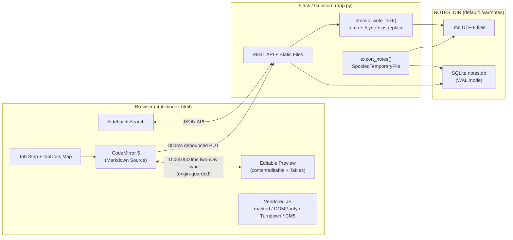
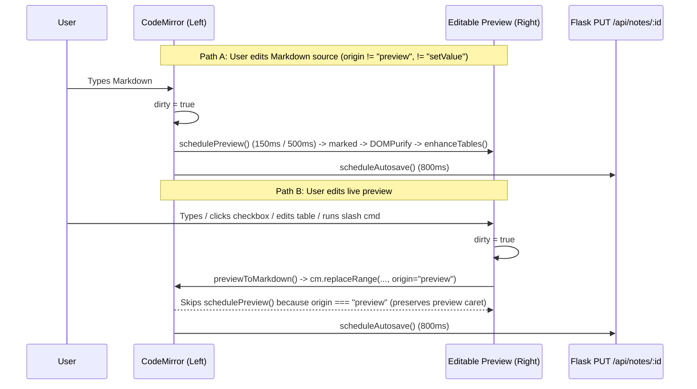

# Architecture

## System Overview

`web-npp` follows a minimal two-tier architecture: a stateless single-file Flask API (`app.py`) serving a single-page vanilla JavaScript application (`static/index.html`) plus local vendored static assets (`static/vendor/`). All state lives in a single data directory (`NOTES_DIR`, defaulting to `/var/notes`), split between SQLite metadata (`notes.db`) and UTF-8 `.md` content files (`<id>.md`).

## Storage Split & Data Ownership

- **SQLite (`<NOTES_DIR>/notes.db`):** Authoritative source for note IDs (`id`), display names (`filename`), recorded filesystem paths (`path`), and last-modified timestamps (`updated_at`). Never stores note body text.
- **Filesystem (`<NOTES_DIR>/<id>.md`):** Authoritative source for note content, stored as UTF-8 text with exact newline preservation (`newline=""`).
- **Path generation invariant:** `note_file_path(note_id)` (`app.py:79-86`) derives every read, write, and export path strictly from the integer `note_id` (`(notes_dir / f"{note_id}.md").resolve()`) and asserts `path.parent == notes_dir`. User-provided `filename` strings are **never** used to construct disk paths.

## Concurrency & Durability

### Database Initialization & Connections (`app.py:19-72`)
- `init_db()` initializes `NOTES_DIR` and creates the `notes` table lazily on the first database access, guarded by a process-local `threading.Lock()` and `_initialized_dirs` set.
- Enables SQLite Write-Ahead Logging (`PRAGMA journal_mode=WAL;`) and uses `timeout=30.0` seconds on connections so multi-worker/multi-thread Gunicorn setups (`gunicorn -w 2 -k gthread --threads 4`) handle concurrent reads and writes without lock errors.
- Each request gets a single connection stored on `flask.g.db` (`get_db()`) and closed automatically by `@app.teardown_appcontext` (`close_db()`).

### Atomic File Writes (`app.py:89-107`)
- `atomic_write_text(path, content)` writes to a sibling temporary file created via `tempfile.mkstemp(dir=path.parent, prefix=f".{path.name}.", suffix=".tmp")`, calls `handle.flush()` and `os.fsync(handle.fileno())`, and atomically swaps it into place with `os.replace(tmp_path, path)`.
- On any exception, the temporary file is unlinked in a cleanup block so partial writes never corrupt existing notes.
- In `create_note()` (`app.py:160-174`), inserting the DB row, setting `path`, and writing the empty `.md` file occur before `db.commit()`, with explicit `db.rollback()` on failure.

## Frontend Architecture (`static/index.html`)

The entire client is encapsulated inside one IIFE (`static/index.html:745-2597`) with no global exports.

### Multi-Tab Document Model
- `openTabIds` tracks the ordered array of open note IDs (persisted to `localStorage` under `"notes.openTabs"`).
- `tabDocs` (`Map<number, { doc, editorScroll, previewScroll }>`) caches one `CodeMirror.Doc` instance per open tab.
- Switching between already-open tabs calls `cm.swapDoc(cached.doc)` (`static/index.html:1456`), which:
  - Performs an instantaneous (<1 ms) switch without a network `GET`.
  - Preserves each tab's independent Undo/Redo history, cursor/selection, and scroll offsets.
  - Does **not** emit CodeMirror's `"change"` event, preventing accidental autosaves on tab switch.
- Closing a tab (`closeTab()`, `static/index.html:1512`) flushes and saves if active, removes the ID from `openTabIds`, and deletes its `CodeMirror.Doc` from `tabDocs` to free memory.

### Two-Way Sync Pipeline (Editor ↔ Editable Preview)

Preventing infinite update loops and caret jumps between CodeMirror and the `contenteditable` preview is controlled by CodeMirror's `change.origin` field:

Key synchronization invariants:
1. **`change.origin === "setValue"`:** Re-renders preview if visible, but **never** marks `dirty` or schedules autosave.
2. **`change.origin === "preview"`:** Marks `dirty` and schedules autosave, but **never** calls `schedulePreview()` (overwriting `previewEl.innerHTML` while typing in preview would destroy the DOM selection/caret).
3. **One-way scroll sync (`static/index.html:1107-1119`):** Scrolling CodeMirror scrolls `#preview` proportionally **only when** `#preview` is visible and does not contain `document.activeElement`, preventing feedback loops or jumps while editing in preview.
4. **Adaptive debounce:** Both editor→preview (`schedulePreview`) and preview→editor (`schedulePreviewToEditor`) debounce `150ms` normally and `500ms` when content exceeds `200 KB` (`LARGE_NOTE_BYTES`).
5. **Flush ordering:** `saveCurrentNote()`, `selectNote()`, `closeTab()`, `applyLayout()`, `previewEl` `blur`, and `flushOnUnload()` call `flushPreviewSync()` before reading `cm.getValue()` so pending preview edits are never dropped.

### Serialized Saves (`saveCurrentNote()`, `static/index.html:1286-1339`)
- Tracks `saveInFlight` promise so overlapping saves wait for any active `PUT` to finish before issuing the next one, preventing out-of-order overwrites on the server.
- Clears `dirty = false` optimistically before the network call; if the user types while a `PUT` is in flight, `dirty` flips back to `true` and triggers another debounced save. On HTTP/network failure, `dirty` is restored to `true` and an error status is shown.

## Security Model

| Surface | Protection | Source Reference |
| --- | --- | --- |
| Disk path traversal | Paths derived solely from positive integer `note_id`; verified `path.parent == notes_dir` | `app.py:79-86` |
| ZIP export Zip Slip | `safe_zip_name()` strips `/\:*?"<>|` and control chars, trims leading dots, deduplicates case-insensitively | `app.py:110-128` |
| Oversized payloads | Flask `MAX_CONTENT_LENGTH` (6 MB) + explicit UTF-8 byte check against `MAX_NOTE_BYTES` (5 MB) returning `413` | `app.py:12-17`, `app.py:131-133`, `app.py:215-216` |
| XSS in Markdown preview | All `marked.parse()` output passes through `DOMPurify.sanitize()` before setting `previewEl.innerHTML` | `static/index.html:967-970` |
| Raw HTML `<input>` / links | `DOMPurify` hook forces `target="_blank" rel="noopener noreferrer"` on `<a>`, strips any `<input>` except disabled GFM task checkboxes (which are then enabled safely), and preview `paste` forces plain text | `static/index.html:791-805`, `static/index.html:2338-2344` |
| Slash `/link` & `/image` URLs | Validated against `/^(https?:\/\/|\/)/i` before inserting `<a>` or `` | `static/index.html:1717-1752` |
| Export memory safety | `tempfile.SpooledTemporaryFile(max_size=10 MB)` spills large archives to disk rather than exhausting VPS RAM | `app.py:252` |
| Authentication | **None in-app** — must be enforced externally via Caddy basic auth, VPN, or firewall | — |
